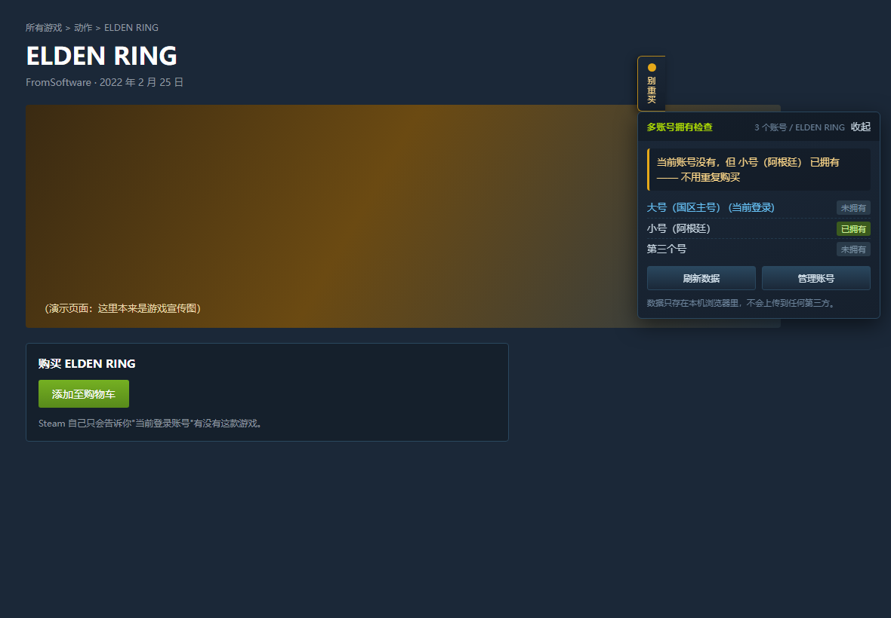
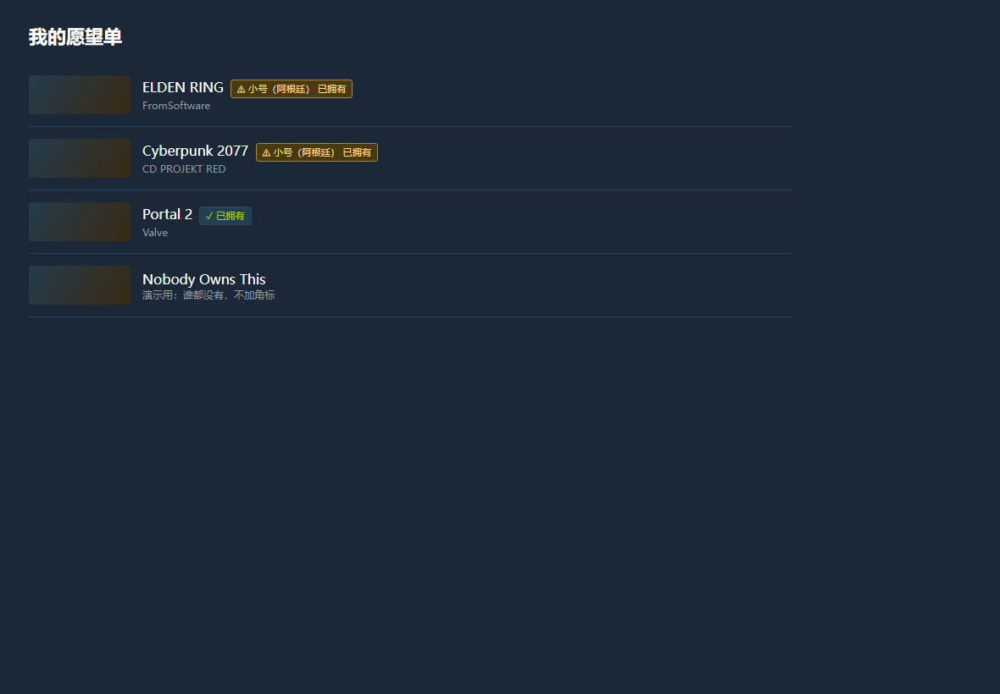
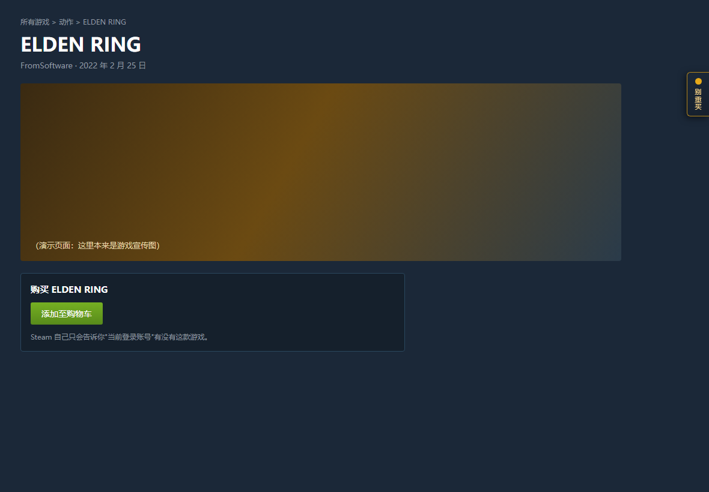
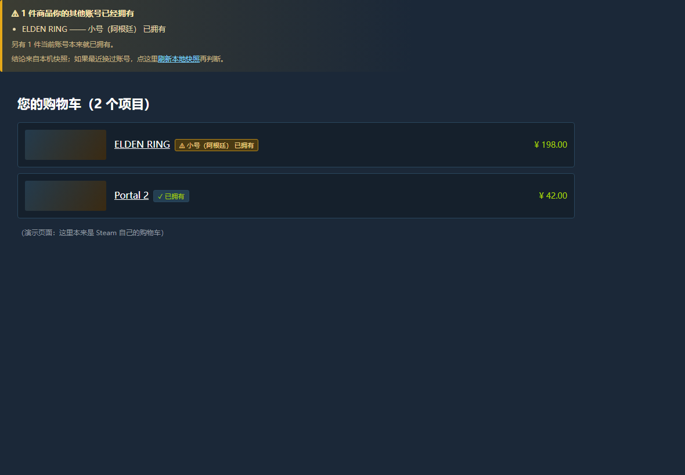

# Steam 多账号拥有检查（Steam Multi-Owner）

> 给"一个人有多个 Steam 账号"的玩家用：把**所有账号的游戏库合并成一张本地索引**，
> 在你浏览商店、愿望单、搜索结果和购物车时，直接告诉你**哪个账号已经拥有这款游戏**，
> 从而不会因为"当前登录的号没有"而重复购买。

**许可**：[MIT](LICENSE) —— 可自由使用、修改、再发布（保留版权声明即可）。
**免责**：本项目与 Valve Corporation / Steam 无关联、未获其授权或认可；"Steam" 是其各自所有者的商标。工具只读你自己账号的数据，请遵守 Steam 用户协议。

Steam 自己只会告诉你**当前登录账号**有没有这款游戏（商店页的"已在库中"）。
如果你有 3 个号，看到"没有"就下单，很可能另一个号早就买过了 —— 这个工具补的就是这个缺口。

---

## 0. 只想用、不想看代码？

**普通用户走这条路就够了：**

1. 下载 [`dist/steam-multi-owner-v1.9.1.zip`](dist/steam-multi-owner-v1.9.1.zip)（仓库 `dist/` 目录里的那个包，只有 71 KB）
2. **解压到一个固定的文件夹**（解压后应能直接看到 `manifest.json`）
3. Chrome 地址栏输入 `chrome://extensions` → 打开右上角**开发者模式** → 点**加载已解压的扩展程序** → 选中刚解压的文件夹
4. 登录一个 Steam 账号 → 点扩展图标 → **「导入当前登录的号」**

⚠️ 注意：**必须解压**，Chrome 不能直接加载 zip；也**不要**把文件夹放在"用完就清"的临时目录里 —— 扩展是引用它运行的。

> 为什么不发 `.crx`？Chrome 稳定版已禁止从商店之外直接安装 crx，"开发者模式 + 加载已解压"是唯一稳定可用的方式。
> 上架 Chrome 应用商店是另一条路（要审核、隐私说明），目前没走。

**详细的图文步骤、首次配置、日常用法、更新方法、常见问题**：见 [INSTALL.md](INSTALL.md)。

**给开发者**：直接用 `git clone` 下来的仓库根目录当扩展目录也行（根目录本身就是可加载的扩展目录，
Chrome 只读 `manifest.json` 引用的 `src/` 与 `icons/`，`test/ tools/ docs/ dsh/` 对它没有影响）。

---

## 1. 三种形态，按场景挑

| 形态 | 适合 | 需要什么 | 状态 |
|---|---|---|---|
| **Chrome 扩展**（推荐，主力） | 电脑上浏览 Steam 时自动标注 | Chrome/Edge（或手机上支持扩展的 Kiwi 等浏览器） | 已验证可用 |
| **移动端离线单文件页** | 手机（Chrome for Android 不支持扩展） | 把扩展导出的 JSON 传到手机 | 已验证可用 |
| **DSH 插件** | 在 DSH 会话里直接问"我的哪个号有这款游戏" | DSH Desktop | 已装好并跑通 |

三者的**判断逻辑是同一份代码**（`src/lib/core.js`），所以结论一定一致。





**面板可以收进右边缘**（点标题收起 → 变成贴边小标签"别重买 / 已拥有 / 未拥有"，点它再展开）。
"别的号已经拥有"时**强制展开**——那是最值钱的提醒；其余情况沿用你上次的选择，不挡页面。



**购物车 / 支付页会做重复购买统计**：列出哪些商品被哪个账号拥有，并给每件商品打上角标；
支付页的措辞是"付款前先看一眼"。



> 截图里的 ELDEN RING / Cyberpunk 2077 只有"小号（阿根廷）"拥有 → 显示琥珀色警告；
> Portal 2 当前账号自己就有 → 显示绿色"已拥有"；谁都没有的条目**不加任何角标**（不做噪音）。

---

## 2. 快速开始（Chrome 扩展）

1. 打开 `chrome://extensions/`，右上角开启**开发者模式**。
2. 点「加载已解压的扩展程序」，选择本目录（含 `manifest.json` 的那一层）。
3. 点扩展图标 → 「导入当前登录账号」（**不需要 API key，也不要求档案公开**）。
   先在浏览器里登录你的某一个 Steam 账号，点一下即可把它整个库快照进来。
4. 换另一个 Steam 账号登录（或用无痕窗口 / 另一个 Chrome 配置文件），重复第 3 步。
   每个账号都会作为一条记录留在扩展里，**每次导入只覆盖它自己那条**。
5. 打开任意 Steam 游戏页 / 愿望单 / 购物车 / 搜索页，就会看到角标与详情面板。
6. 在设置页把「当前登录账号」设成你现在正在用的这个号 —— 这样"别的号有、当前号没有"才会被标成警告。

> **弹窗里就能加账号**：点开扩展图标后，「我的账号」区里有
> 「**导入当前登录的号**」（免 key）和「**＋ 添加账号**」（按 SteamID，需要 API key）两个入口，
> 不用先跳去设置页。设置页适合批量管理、改名、导入导出。

### 账号的三种接入方式

| 方式 | 需要 | 拿得到什么 | 什么时候用 |
|---|---|---|---|
| **登录态导入**（弹窗或设置页） | 浏览器里登录该账号 | 该账号完整库（含免费游戏） | 首选。不需要 key、不需要公开档案 |
| **Steam Web API**（共享 key + SteamID） | 一个 [API key](https://steamcommunity.com/dev/apikey)，且目标档案的「游戏详情」为公开 | 任意公开档案的完整库（含游戏名） | 想后台自动刷新、想查别人的号 |
| **社区公开档案**（自动回退） | 档案公开 | 库（常常没有游戏名） | 上面两条都走不通时的兜底 |

一个 API key 可以查所有"游戏详情公开"的账号，所以通常只需要一个共享 key。

---

## 3. 手机怎么用

Chrome for Android 不支持扩展，所以手机走**离线单文件页**：

1. 电脑扩展设置页 → 「导出 JSON」→ 复制（或存成 `.json`）。
2. 把 `mobile/index.html`（单文件，46 KB）传到手机，用浏览器打开（`file://` 即可，不需要服务器、不需要联网）。
3. 粘贴 JSON → 导入。之后输入 AppID、商店链接或游戏名，就能看到结论卡和逐账号的"已拥有 / 未拥有 / 未同步"，每行还有「打开商店页」。
4. 可以"添加到主屏幕"当离线小应用。

> 如果手机浏览器支持扩展（Kiwi Browser、Yandex 等），直接装这个扩展体验更完整。

---

## 4. 在 DSH 里直接用

已经装好并验证通过的 DSH 插件提供三个工具（在会话里直接调用）：

- `steam_owner_check` —— 查一款游戏被哪个账号拥有（支持 AppID / 商店链接 / 游戏名）
- `steam_owner_accounts` —— 查看 / 添加 / 删除 / 清空账号
- `steam_owner_data` —— 导入（粘贴扩展导出的 JSON）/ 导出 / 用 API 同步 / 切换"当前登录账号"

推荐流程：**在扩展里点「导出 JSON」，把内容交给 `steam_owner_data` 的 `import`** ——
这样 DSH 侧不需要 API key，也不需要再登录一次 Steam。

实际效果（真机输出，非示例编造）：

```
AppID 1245620（ELDEN RING）
当前账号没有，但 小号 已拥有 —— 不用重复购买
  · 大号：未拥有 ←当前登录
  · 小号：已拥有
  · 国区号：未拥有
结论：当前账号不需要重复购买。
```

### DSH 插件开发中踩到的坑（都已写进 `dsh/cordis.patch.yml` 注释）

1. **patch 必须用 `insert:` 包一层**。顶级裸行是"按 id 覆盖已有条目"，写在顶层会**静默不生效**。
2. **作用域名要加引号**：`name: '@local/steam-ownership'`。YAML 里 `@` 是保留指示符，不加引号直接解析失败。
3. **loader 按解析后的文件路径缓存模块代际**。同一个目录改了代码，无论怎么开关 bundle 都还是旧代码在应答
   （磁盘上的文件明明是新的 —— 这个坑最迷惑）。解法是用 `tools/pack-plugin.mjs` 打包到
   `dsh-install-<新版本>/` 这个没被导入过的新路径，再改从它安装。
4. **不要给本地 bundle 起 `dsh-` 开头的包名**。`@local/dsh-steam-owner` 这种名字会让加载器去 DSH
   自身安装位置解析，结果是永远 `failed to import`，而纯 Node `import()` 却完全正常 —— 排查了很久。
5. **loader 的注册表在长命进程里会积累多代同名工具**。反复装卸同一个包名（或同名工具）时，旧代际可能
   继续应答；把插件彻底卸干净后重装、或重启一次 DSH，状态才会干净。

另外 DSH 要求工具返回值是 **lossless JSON**：返回值里只要有一个 `undefined`，
整次调用就会以 `value is not lossless JSON` 失败，且不告诉你哪个字段。
插件内置了等价的自检（`isLosslessJson`），失败时报出精确路径；
`tools/diagnose-plugin-output.mjs` 用 DSH **真实的**校验器交叉验证两边判定一致。

---

## 5. 目录结构

```
steam-multi-owner/
├─ manifest.json            Chrome MV3 清单（权限只有 storage/alarms + 3 个 Steam 域名）
├─ INSTALL.md               ★ 面向使用者的安装/使用说明（普通用户看这个就够）
├─ dist/
│  └─ steam-multi-owner-v<版本>.zip   ★ 打包好的扩展：下载 → 解压 → 加载已解压的扩展程序
├─ src/
│  ├─ lib/core.js           ★ 纯逻辑真源：解析、索引、判断、数量口径（无 chrome.*/DOM/IO）
│  ├─ lib/steam-api.js      IO 层：所有请求都注入 fetch，便于测试；含会话 token / 类型分类
│  ├─ bg/background.js      MV3 service worker：唯一的真源（账号、快照、索引）
│  ├─ content/content.js    页面侧：找 appid → 问后台 → 画角标/面板/购物车警告
│  ├─ content/content.css
│  └─ ui/                   popup（含"＋ 添加"内联表单）+ options 页面
├─ dsh/                     ★ DSH 插件的**源**（bundle，改这里）
│  ├─ package.json          dsh.bundle.patch 指向 cordis.patch.yml
│  ├─ cordis.patch.yml      插入插件行（含踩过的坑的注释）
│  └─ lib/index.js          3 个工具 + 输出自检；lib/core.js 与 lib/steam-api.js 是同步副本
├─ dsh-install-<版本>/       打包产物：真正装进 profile 的那一份（由 tools/pack-plugin.mjs 生成，不进 git）
├─ mobile/
│  ├─ app.html              移动端页面源模板
│  └─ index.html            构建产物：内联 core.js 的单文件（构建生成，勿手改）
├─ test/                    54 个核心单测 + 19 个插件单测
├─ tools/                   验证器、打包（zip / DSH 插件）、构建、截图、诊断脚本
└─ docs/                    真机截图
```

`src/lib/core.js` 是唯一的逻辑真源；DSH 插件和移动端页面各自持有一份**副本**，
`node tools/sync-plugin-lib.mjs --check` 与单测会校验副本与真源逐字节一致，防止悄悄分叉。

**为什么插件要打包成另一个目录**：DSH 的加载器按**解析后的文件路径**缓存 JS 模块代际。
同一个目录改了代码后，无论怎么开关 bundle，跑的都还是旧代码（磁盘上的文件明明是新的，
工具返回的却是老逻辑 —— 这个坑极具迷惑性）。`tools/pack-plugin.mjs` 会把 `dsh/` 复制成
`dsh-install-<版本>/`，换个没被导入过的路径，于是**不用重启 DSH** 就能让改动生效。
改了插件代码后的标准流程：

```bash
node tools/sync-plugin-lib.mjs      # 若 core/api 变过
node tools/pack-plugin.mjs          # 生成 dsh-install-<新版本>/
# 然后在会话里：plugin_manager remove_bundle <旧包名> → install_bundle <新目录>
```

顺便记一个更要命的坑：**不要给本地 bundle 起 `dsh-` 开头的包名**（例如 `@local/dsh-steam-owner`）。
加载器会优先从 DSH 自身安装位置解析 `dsh*` 包，于是指向本地目录的那个永远 "failed to import"，
而纯 Node 里 `import()` 又是成功的 —— 排查了很久才发现是命名问题。

---

## 6. 验证：跑得出结果的部分

```bash
node --test test/core.test.mjs        # 54 通过 —— 解析/索引/回退链/角标语义/数量口径/会话 token/类型分类
node --test test/dsh-plugin.test.mjs  # 19 通过 —— 插件工具逻辑 + DSH 输出契约
node tools/diagnose-plugin-output.mjs # 15/15 —— 用 DSH 真实校验器验输出
node tools/build-mobile.mjs           # 构建移动端单文件（幂等）
node tools/test-mobile.mjs            # 35 通过 —— 移动端页面在 vm+假 DOM 里真跑
node tools/verify-extension.mjs       # 44 通过 —— 真机 Chrome 加载扩展后逐项断言
node tools/sync-plugin-lib.mjs --check # 插件副本与真源逐字节一致
node tools/pack-plugin.mjs            # 打包成可安装的 dsh-install-<版本>/
```

`verify-extension.mjs` 做的是**真机验证**，不是静态检查：

- 用 `Extensions.loadUnpacked` 把扩展装进真实 Chrome（注意：Chrome 正式版已禁用 `--load-extension`，
  官方给自动化留的入口就是这个 CDP 命令 + `--enable-unsafe-extension-debugging`）。
- 断言 service worker 注册、`importScripts` 生效、无未捕获异常。
- 从扩展页面通过**真实消息通道**跑多账号用例，逐条核对结论。
- 用 CDP `Fetch` 拦截网络**伪造 Steam 商店页/愿望单**，确认 content script 真的把面板和角标画了出来。

截图：`node tools/screenshot.mjs` → `docs/*.png`。

> 本机 `store.steampowered.com` / `steamcommunity.com` 的 DNS 出不去（只有 `api.steampowered.com` 通），
> 所以"登录态导入 / 社区档案"这两条真实链路**没有在这台机器上端到端跑过**，
> 它们靠单元测试（注入假 fetch）+ 真机渲染验证。在你自己的浏览器里网络正常，这两条会正常工作。

---

## 7. 关键设计决策

**数量的口径：索引要全，但显示的游戏数必须准。**
Steam 有两条完全不同的数据来源，数字能差 4 倍：

| 来源 | 拿到什么 | 典型数字 |
|---|---|---|
| `IPlayerService/GetOwnedGames`（会话 token 或 API key） | **只含游戏本体**，还带游戏名 | 71 款 |
| `dynamicstore` 的 `rgOwnedApps` / 许可证页面 | **拥有的条目**：含 DLC、原声、工具（SteamVR/Proton/运行库）、免费应用、家庭共享 | 305 项 |

所以本工具的做法是：**索引把两者并集收全**（这样 DLC 的拥有情况也能识别，判"有没有"时只会更宽松、不会漏判），
但**显示时以游戏数为主**，条目数作为补充：

```
大号（国区主号）   4 款游戏
小号（阿根廷）     3 款游戏（另 20 项 DLC/工具）
第三个号           2 款游戏
索引覆盖 27 个 AppID
```

登录态导入的实现（`fetchSessionLibrary`）按准确性分三级：
1. 从商店页面里读当前会话自带的 `webapi_token` + `steamid`（**不需要你申请 key**）→ 调 `GetOwnedGames` 得到准确的游戏集合；
2. 再取许可证条目列表，与上面的游戏集合**合并**：`appids` 取并集、`gameAppids` 用第 1 步的结果；
3. 万一拿不到 token：用商店详情接口按批分类（`type === 'game'`）反推游戏数；分类不了就照实显示"游戏数待识别"，
   **绝不把条目数冒充成游戏数**。

**「没查到」绝不等于「没有」。** 这是最重要的一条。
档案私密、账号还没同步时，工具**不会**说"你没有这款游戏"，而是：

- 一个账号都没同步 → 结论是「无法判断」；
- 只同步了一部分 → 结论带 `incomplete`，文案写明「已同步的 N 个账号都没有；另有 M 个账号未同步，结论不完整」。

理由是：给一个假的安全结论，会直接害你重复购买（或误以为不用买）。

**快照必须能证明"这是哪个号的数据"。** 真机上出过一次严重事故：换号导入时，
新号的库被写进了旧号的记录里，于是面板把人**已经拥有**的游戏显示成"未拥有"。为此加了三道防线：

1. **按 SteamID 认账号**（`Core.pickSessionAccount`）：换号导入只会**新增**记录，绝不覆盖别的号；
   读不到 SteamID 时退回更新登录态记录，但会标记「身份未确认」并在界面上报警。
2. **身份核对**：每次导入都记录 SteamID / 昵称 / 抓取时间；页面里的 SteamID 与数据里的 `steamid`
   不一致会直接报冲突。
3. **与 Steam 页面交叉校验**：如果 Steam 自己写着 "already in your Steam library"，
   而本地快照说"都没有"，面板会明确弹出警告并让你刷新，而不是默默给错答案。

**所有商店请求禁用 HTTP 缓存**（`cache: 'no-store'` + URL 加 cache-buster）。
换账号后如果吃到上一个账号的缓存响应，就会出现"抓到的库属于别的号"这种离谱现象。

**账号密码登录是故意不做的。** 在扩展里收你的 Steam 密码意味着要自己实现 RSA 加密登录、
处理 Steam Guard，而且**无论如何都会改变浏览器的 Steam 登录态**（Cookie 是共享的），
风险大于收益。取而代之的是「去 Steam 登录另一个号」按钮：打开官方登录页
（Steam Guard 交给 Steam 自己），登录完回来点「导入当前登录的号」即可按 SteamID 新增记录。
不想动浏览器登录态的账号，请用「＋ 添加」走 SteamID + API key 那条路。

**「同步」能刷什么、不能刷什么（重要）**

| 账号类型 | 单条 ⟳ / 同步全部 | 说明 |
|---|---|---|
| 登录态导入的号，**且**它就是浏览器当前登录的号 | ✅ 能刷新 | 走会话 token + `GetOwnedGames`，数字最准 |
| 登录态导入的号，**但**当前登录的是别的号 | ⛔ **跳过**并说明原因 | 登录态数据只对"当前会话"有效。想刷新它：先切到该号登录，或给它配 API key |
| 用「＋ 添加」填了 SteamID + API key 的号 | ✅ 能刷新 | 与浏览器登录态无关；要求该档案「游戏详情」公开 |

「跳过」不是失败 —— 不写账号的错误标记，`同步全部` 会逐条报告「已刷新 N 个 / 跳过 M 个 / 失败 K 个」。
这是修掉"拿当前登录号的数据去覆盖别的号"那个事故的直接结果：**宁可跳过，也不给错数据**。

**在别处买了游戏（手机 / 客户端 / 另一台电脑）怎么更新？**

| 情况 | 怎么办 | 耗时 |
|---|---|---|
| 买在**当前浏览器登录的那个号** | 点面板「刷新数据」或弹窗 ⟳（推荐用「导入当前登录的号」，顺带补名字和 SteamID） | 1–2 秒 |
| 买在**另一个号** | ① 点「去 Steam 登录另一个号」→ 登录 → 「导入当前登录的号」；或 ② 给那个号配 **API key**，之后随时一键刷 | 10 秒 / 0 秒 |
| 只想确认"我现在这个号有没有" | **不用刷新** —— 当前登录账号在游戏页是**实时**查的（面板第一行那行就是） | 0 |

设置页的「自动刷新」（N 小时）能自动更新的只有 **API key 账号**，以及定时器恰好跑到时"当前登录的那个号"——
其余登录态账号仍然需要切号，这是 Steam 的限制，不是省掉的功能。

> 面板上的「刷新数据」现在会**逐条报告结果**（谁刷新了、谁被跳过、为什么），
> 因为以前"点了没反应"最容易被误解成工具坏了。

**只标注需要你知道的。** 谁都没有的游戏不加任何角标 —— 否则商店首页会变成一片噪音。

**购物车 / 支付页的警告要"抓得住"也要"活得久"。** 真机上这里出过两个问题，都修了：
- **抓得住**：不依赖 Steam 的容器 class（改版就会失效），而是扫"每件商品都链到它的商店页"这个几乎不会变的事实
  （`a[href*="/app/"]`），再把各种可能的 `data-*appid*` 属性兜一遍。宁可多查几个 appid（查本地索引不花钱），也不能漏 —— 漏了就是重复花钱。
- **活得久**：警告条插在 Steam 自己的 React 根容器**之外**（作为它的前一个兄弟节点），并做成吸顶；
  塞进根节点内部会被 React 的重渲染抹掉，这也是真机上"购物车什么都没弹"的原因之一。

**数据只在本机。** 账号列表、库快照、索引全部只写在 `chrome.storage.local`；
扩展只访问 3 个 Steam 域名，没有统计、没有埋点、没有远程代码。导出的 JSON **不包含 API key**。

**权限最小化。** 只要 `storage` + `alarms`，没有 `tabs` / `scripting` / `webRequest` / `<all_urls>`。

**索引在本地，浏览时不发请求。** 抓库是一次性的（每个账号一次），之后所有页面标注都是查本地索引，
所以不会有 Steam 商店接口的限流问题（那个接口大约 1 req/s，很容易被限）。

---

## 8. 真实链路验证（对着真 Steam 跑出来的结论）

这台机器一开始连不上 `store.steampowered.com`，原因是本地代理（fake-IP `198.18.0.x`）只被浏览器使用，
而 Node 的 `fetch` 不读系统代理。代理恢复后，下面这些**以前只靠假设**的地方已经逐条对过真机：

| 事情 | 真机结论 | 因此改了什么 |
|---|---|---|
| 登录态信息挂在页面哪里 | `#application_config` 上确实有 `data-store_user_config` 与 `data-userinfo` | 解析目标没错 |
| `webapi_token` 长什么样 | **只有 HTML 转义形态** `&quot;webapi_token&quot;`，裸 JSON `"webapi_token"` 根本不存在 | **这就是一直拿不到准确游戏数的根因** —— 原正则只认裸形态，已补上转义形态 |
| 未登录怎么判断 | 页面明确给 `data-userinfo` 里 `logged_in:false` | 用它做前置判断，未登录直接报错 |
| 未登录时的 `dynamicstore/userdata` | **返回 HTTP 200 + 空数组**（不是报错！） | 以前会建出一个"0 款游戏"的空账号，现在明确报"没有登录 Steam" |
| `appdetails` 能否批量 | **不能**：`appids=440,570` 返回 HTTP 400，只能逐个查 | 分类改成逐个查；并坚持"分类不完整就不给游戏数"，避免把 71 款报成 12 款 |
| 商店不公开的 appid | 像 `228980` 返回 `success:false` | 单独归类为"商店无公开信息"，既不算游戏也不算失败 |
| 社区游戏列表接口 | **现在要求登录**（未登录 302 跳 `/login/`） | 提示改成"该接口要求登录"，不再误导成"档案未公开" |
| `appuserdetails` | 存在；未登录返回 `{"440":{"success":false}}` | 新增为**实时校验兜底**：只用 cookie，不需要 token / API key |

另外加了一条集成测试：**在真实 Steam 页面上**（不伪造任何网络）打开 `store.steampowered.com/app/440/`，
断言面板注入成功、`#application_config` 存在、面板内容里没有 `undefined/NaN`，
并且未登录时给的是"无法判断"而不是"没有"。

复现这些结论：

```powershell
node tools/probe-live2.mjs     # 商店页结构 / 社区 XML / appdetails / dynamicstore
node tools/probe-live3.mjs     # 复验本轮修复（未登录报错、社区需登录、逐个分类…）
node tools/probe-api.mjs       # 真实 Web API 的错误处理（401/403）
```

---

## 9. 已知限制

- **私密档案读不到库。** 需要目标账号的「游戏详情」公开，或者用"登录态导入"。
  纯私密 + 不想登录 → 只能手动粘贴游戏列表（当前版本未提供该入口，属已知缺口）。
- **"登录态导入"一次只能导一个账号。** 因为浏览器一次只登录一个 Steam 账号 ——
  多账号就是"依次登录各导一次"，扩展会把每次结果分别保存。
- **数字口径要看清"款游戏"还是"项"。** 索引里含 DLC/工具/家庭共享等条目是**有意的**
  （这样 DLC 的拥有情况也能识别），但显示会以游戏数为主；只有当账号还没识别出游戏集合时，
  才会显示「N 项（含 DLC/工具，游戏数待识别）」。若你看到某个号是这种状态，重新点一次导入/同步即可
  （新版本会走会话 token 拿到准确游戏数）。
- **Steam Families（2024）能覆盖一部分场景**：家庭成员之间商店页会显示 "IN STEAM FAMILY LIBRARY"。
  但它最多 6 人、要求同区、有 1 年冷却，且**不会告诉你具体是哪个账号拥有**；自己的多个小号也未必适合塞进一个家庭。
  本工具与之不冲突。
- **游戏名模糊查询只对"有名字的库"有效。** 通过社区公开档案抓到的库常常没有游戏名
  （只有 appid），这类库只能按 AppID 查。
- **Steam Web API 软上限约 10 万次/天/key**，正常用量远远够。
- **自动后台刷新只对配了 API key 的账号有效**；登录态导入的账号需要你手动点一下刷新。
- 移动端页面是单文件离线版，**不含**"从 Steam 直接抓库"的能力（浏览器跨域限制），只做本地查询。

---

## 10. 与现有工具的差异（先调研再动手）

调研过的同类工具（[Steam Web Integration](https://github.com/Revadike/SteamWebIntegration)、
[Augmented Steam](https://addons.mozilla.org/en-US/firefox/addon/augmented-steam/)、
SteamDB 扩展、[steam-family-game-analysis](https://scriptcat.org/en/script-show-page/7267)、
"Already Own?"、"Do I own this game?"、SteamWatch、Steam-Organizer 等）：

**它们都只绑定一个身份** —— 要么是当前登录的会话，要么是"一个 API key + 一个 steamid"，
要么是一份导入的库列表。没有任何一个能接受**两个以上 Steam 身份**并回答
"我的**任意一个**账号拥有这款游戏吗？是哪个？"。

最接近的三个：`steam-family-game-analysis`（跨账号标注商店页，但仅限 Steam 家庭组，且依赖当前登录会话）、
"Already Own?"（扫 cookie 在商店页标注，一个浏览器一个账号）、
"Do I own this game?"（可导入多来源库，但只用于捆绑包站点，不支持 Steam 商店页）。

所以本工具补的正是这个缺口：**N 个身份 → 合并索引 → 在商店/愿望单/搜索/购物车回答"谁有"**。

---

## 11. 故障排查

| 现象 | 原因与处理 |
|---|---|
| 面板说"没有这款游戏"，但 Steam 页面写着 "already in your Steam library" | 新版本会直接报警。按提示点「刷新数据」；并确认浏览器当前登录的就是你要抓的号。根因是快照抓成了别的账号（老版本会覆盖同名记录） |
| 导入后账号名/数量像是别的号的 | 老版本会把新号的库写进旧记录。请在设置页删掉那条没有 SteamID 的旧记录，重新导入（新版本按 SteamID 新增，不会覆盖） |
| 点「导入当前登录的号」提示"未检测到已登录的 Steam 会话" | 先在同一浏览器里登录 `store.steampowered.com`，再点导入 |
| 数字比 Steam 档案里的"游戏数"大很多（例如 305 vs 71） | 旧版本把"许可证条目数"当成了游戏数。**重新导入一次**即可走会话 token 拿到准确游戏数；界面也会显示"项（含 DLC/工具，游戏数待识别）"而不是硬说成"款游戏" |
| 某个账号同步失败"档案的「游戏详情」未公开" | 该账号隐私设置里把「游戏详情」设为公开；或用登录态导入 |
| 角标显示"待同步" / 结论是"无法判断" | 该账号还没有库快照，点「刷新数据」或去设置页同步 |
| 结论说"另有 N 个账号未同步" | 正常提示，不是 bug：没同步的账号无法判断，补齐同步即可 |
| 商店页没有面板 | 检查设置里「在游戏页显示详情面板」是否被关掉；或该页不是 `/app/<id>` 页面 |
| 购物车没有警告条 | 只在"**其他**账号拥有、当前账号没有"时才出现；先确认设置里的「当前登录账号」选对了。若确实该出现却没有：**保持购物车页面打开**，去设置页第 5 节跑「诊断」—— 输出里的 `[7]` 段会列出真实行结构（class 名、有没有"移除"控件、每个 `/app/` 链接的祖先链） |
| 购物车出现灰色"没能识别出具体是哪几件" | 这是**软提示**（不对任何游戏下结论）：三个来源（`data-cart_config` / 行内"移除"控件 / 容器选择器）都没匹配上。把该页面的诊断 `[7]` 段发给开发者即可精确适配，不用再猜 |
| 购物车是空的却报了"已拥有" | 老版本全页扫链接，把"为您推荐"里的游戏也算成了购物车商品（已修）。现在先判空、再靠"移除"控件圈定商品行，推荐位一律不算 |
| 提示里只有 `AppID 292030`，看不出是哪个游戏 | 名字优先取本地索引，索引里没有就取**页面上的商品标题 / 游戏名**（已修）；只有页面也没写名字时才退化成 AppID |
| DSH 插件报 `value is not lossless JSON` | 插件代码没更新到最新代际（同路径模块被缓存），用 `tools/pack-plugin.mjs` 打包到新目录再装，或重启 DSH |
| DSH 插件报 `failed to import` | 两种情况：① 插件包名以 `dsh-` 开头（加载器会去 DSH 自身安装位置找，永远失败）；② 插件目录缺 `node_modules`，在 `dsh/` 下跑一次 `pnpm install` |
| 改了插件代码但工具行为没变 | 同路径模块代际缓存。跑 `node tools/pack-plugin.mjs` 生成 `dsh-install-<新版本>/` 并改从它安装 |

---

## 12. 怎么更新（两个形态完全不同）

### Chrome 扩展：改文件即生效，只需"重新加载"

扩展是以「加载已解压的扩展程序」的方式装的，所以**代码就是磁盘上这份文件**，没有构建、也没有商店审核。

1. `chrome://extensions/` → 找到本扩展 → 点卡片上的**重新加载**（🔄）。
2. **刷新所有已经打开的 Steam 标签页**（F5）。这一步不能省：已打开页面里跑的还是旧的内容脚本。
3. 验证：打开扩展弹窗，标题右边应该显示版本号 **v1.9.1**；设置页右上角同样显示 `v1.9.1`。
4. 若扩展卡片报错（红字 "Manifest" 之类），说明文件被移动过：删掉它，重新「加载已解压的扩展程序」并选中本目录。

> **重新加载不会清空数据**：`chrome.storage.local` 里的账号和快照会保留。
> 升级后如果数据是旧版本写的（例如记录没有 SteamID、数量口径是旧的），
> 请到设置页把可疑记录删掉再重新导入 —— 这样格式与数字都会是新版的。

### DSH 插件：必须"打包到新目录 + 重启一次"

DSH 的 loader 按**解析后的文件路径**缓存 JS 模块代际，而且长命进程里会累积多代同名工具注册。
所以改完 `dsh/` 里的代码，光开关 bundle 是不够的：

```bash
cd C:\dev\steam-multi-owner
node tools/sync-plugin-lib.mjs      # 若 src/lib/core.js 或 steam-api.js 变过
node tools/pack-plugin.mjs          # 生成 dsh-install-<新版本>/
# 然后在 DSH 会话里：
#   plugin_manager remove_bundle  @local/steam-ownership
#   plugin_manager install_bundle C:\dev\steam-multi-owner\dsh-install-<新版本>
# 最后重启一次 DSH —— 这一步是让注册表彻底干净的唯一可靠办法
```

**验证是否更新成功**：让会话执行 `steam_owner_data`（`action: "status"`），
输出第一行必须是 `插件版本：v1.4.2`。如果显示 `vunknown`，说明应答的仍是旧代际 → **重启 DSH**。

> **实测记录（为什么"重启"是必需而不是建议）**：连续装了 1.4.0 → 1.4.1 → 1.4.2 三个**不同目录**的副本，
> 版本号都显示 `vunknown`。而 1.4.2 的版本号是**打包时以字面量替换进代码**的
> （`const PLUGIN_VERSION = '1.4.2'`，零运行时 IO、零动态解析），它**不可能**返回 unknown。
> 结论：长命进程里会累积多代同名工具注册，**旧代际仍在应答**，换目录也绕不过去 ——
> 必须重启一次 DSH 才能让注册表干净。版本号那一行就是为识别这种情况加的。

（这两步我都可以在会话里替你做完；你也可以自己在 DSH 侧边栏的「插件」页里安装/替换 bundle。）

---

## 13. 改代码的时候

- 改逻辑请改 `src/lib/core.js` 或 `src/lib/steam-api.js`，然后跑
  `node tools/sync-plugin-lib.mjs` 同步插件副本（单测会校验一致性，忘了同步会红）。
- 改移动端页面请改 `mobile/app.html`，然后 `node tools/build-mobile.mjs` 生成 `mobile/index.html`。
- 改 DSH 插件请改 `dsh/`，然后 `node tools/pack-plugin.mjs` 打包并从新目录安装，然后**重启 DSH**（原因见第 12 节实测记录）。
- 提交前建议按第 6 节把命令都跑一遍。

### 发版清单（改动扩展代码后必须走一遍）

```powershell
# 1) 升版本号：改 manifest.json 的 version（扩展的版本只看它）
# 2) 重新打包给用户下载的 zip —— 忘了这步，用户装到的还是旧版
npm run build:zip
# 3) 确认 dist 里的包与当前源码逐字节一致（专门拦"改完忘了打包"）
npm run check:zip
# 4) 让 Chrome 真的加载一次，证明这个包确实能用（会开一个临时浏览器）
npm run verify:zip
# 5) 回归
npm test; npm run verify
```

> 为什么把 zip 提交进 `dist/`：使用者从 GitHub 页面就能直接下载安装包，不用自己打包。
> 代价是每改一次扩展代码都要重新 `build:zip`，所以第 3 步的 `check:zip` **必须**跑 ——
> 它逐字节比对包内文件与源码，并在 `dist/` 里存在过期包时报错。
> 也可以在 GitHub 发 Release 时把 `dist/*.zip` 作为附件上传（`INSTALL.md` 里两条路都写了）。
- 新增能力时优先在 `core.js` 里写成**纯函数**（无 IO、无环境依赖），这样扩展、移动端、DSH 插件都能共用，
  也才能在 Node 里直接单测。
- 界面上的数字一定要带口径：`Core.describeCount()` / `describeIndex()` / `describeSummary()` 是唯一入口，
  不要在页面里自己拼"X 款游戏"。

## 14. 隐私

所有数据只存在你自己的浏览器里。扩展只访问 `api.steampowered.com`、`store.steampowered.com`、
`steamcommunity.com` 三个域名，请求内容就是"取我的游戏库"，不发送任何账号密码。
Steam Web API key 只保存在本机 `chrome.storage.local`，导出时会自动清空。
